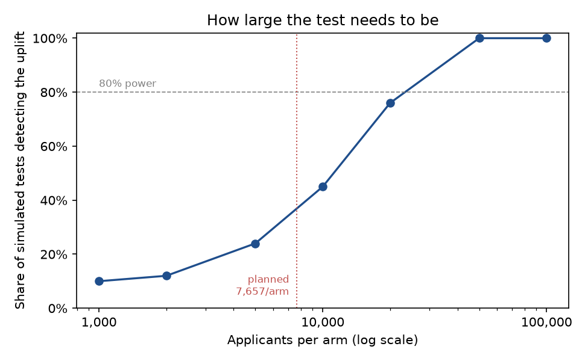

# Champion/challenger experiment readout

**Decision: Launch the challenger.** The optimized policy earned **$86.21 more per applicant** (95% CI $64.60 to $107.82, p = 5.4e-15) while funding 57% of applicants, and its funded loans defaulted at 12.0% vs. 15.0%.

Simulated on the 2015 book: applicants randomly split 50/50; champion funds everyone Lending Club approved, challenger applies the Module 4 policy; a declined applicant earns $0.

## Design (before outcomes)

From model predictions, the challenger was expected to add **$139.31 per applicant** (per-applicant profit SD $3,077, from realized profit on 2013–2014 loans). Detecting that with 80% power at α = 0.05 needs **7,657 applicants per arm**; the book supplies 141,513.

## Readout

| metric | champion | challenger | difference | 95% CI | p-value |
| --- | --- | --- | --- | --- | --- |
| Profit per applicant | $36.36 | $122.57 | +$86.21 | $64.60 to $107.82 | 5.4e-15 |
| Profit per applicant (bootstrap CI) |  |  |  | $66.00 to $108.99 |  |
| Approval rate | 100% | 57.4% | -42.6% |  |  |
| Default rate of funded loans | 14.96% | 11.98% | -2.97% |  | 5.4e-85 |

Applicants: 141,513 champion, 141,513 challenger.

## Decision rule

Launch if the 95% CI of the profit uplift is above $0 **and** funded loans do not default more than the champion's. Profit criterion met (CI lower bound $64.60). Risk guardrail met (11.98% vs. 14.96%).

## Robustness

Re-running the random split 50 times: uplift ranged from $50.94 to $93.76 per applicant and was significant at 5% in **100%** of splits.

Empirical power at smaller test sizes (applicants drawn from the 2015 book):

| applicants_per_arm | power |
| --- | --- |
| 1,000 | 10% |
| 2,000 | 12% |
| 5,000 | 24% |
| 10,000 | 45% |
| 20,000 | 76% |
| 50,000 | 100% |
| 100,000 | 100% |

## Limitations

- A simulation on historical outcomes, not a live test: no behavioral response (declined applicants reapplying elsewhere, competitors) and no seasonality between arms.
- Profit is lifetime (36 months); a live test would read early indicators (30+ days past due at 6 and 12 months) and confirm later.
- The challenger was designed on predictions for this same book; a live rollout would use the next cohort.
