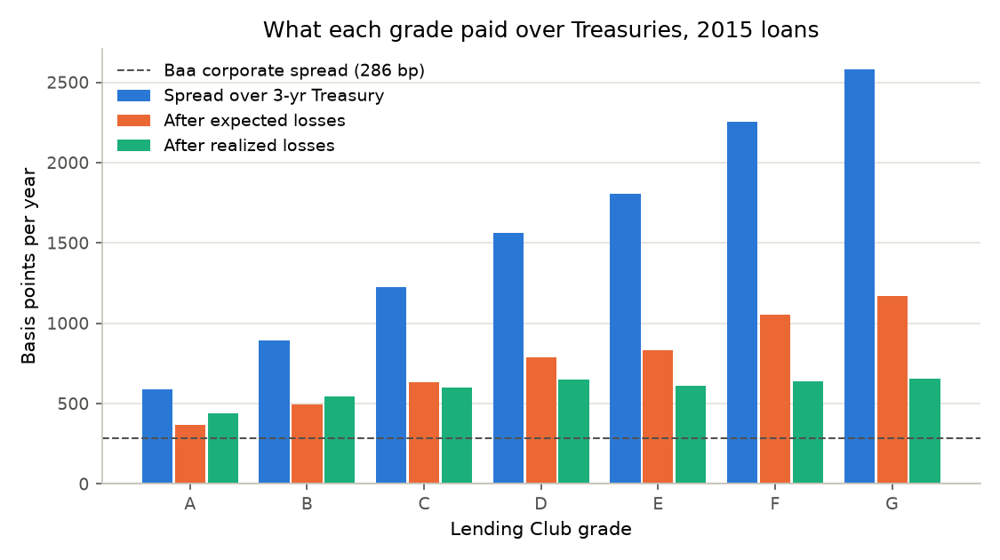
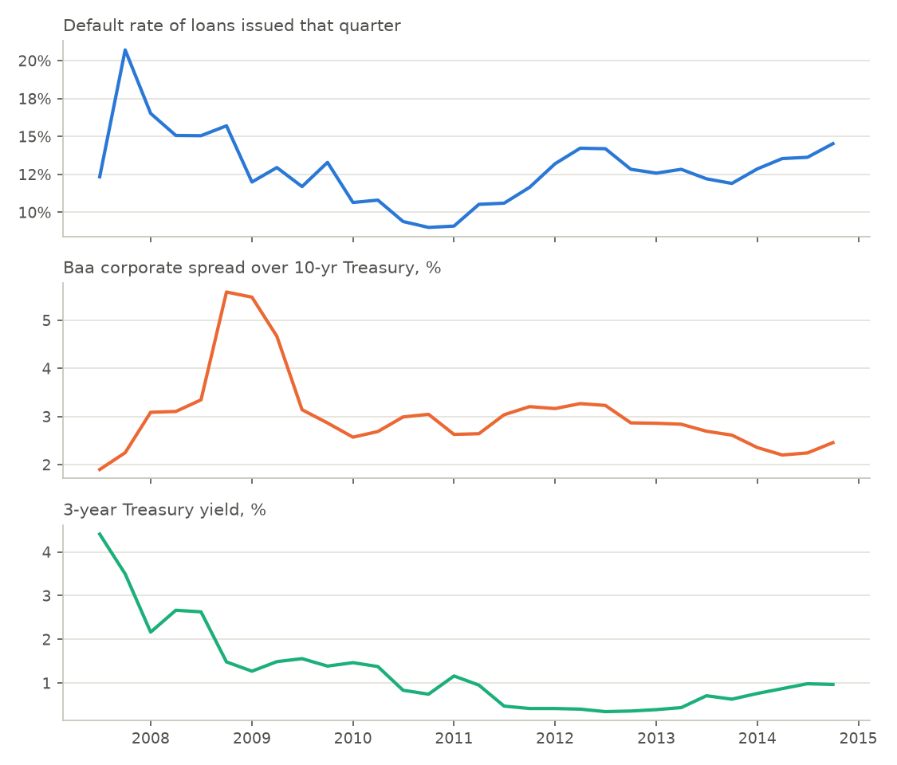

# Rates and credit spreads: the loan book as a fixed-income asset

After expected credit losses, the 2015 book earned **540 bp a year over 3-year Treasuries** (1,003 bp coupon spread less 463 bp of expected loss); after the losses that actually happened, 543 bp. Baa corporate bonds paid 286 bp over the 10-year Treasury in the same months, before any losses.
Grade A loans earned 365 bp after expected losses, +79 bp against the Baa spread.

The book's modified duration is **1.45 years**: a parallel +100 bp move cuts its value by **$51.9M (1.43%)**, a DV01 of $524,081. Funded at a floating rate, each +100 bp would cost $58.9M over the loans' life.

The **unemployment change + baa spread at issue** model predicts 2013–2014 cohort defaults best (out-of-time deviance -104 vs. Module 3's unemployment model).

Book: 283,026 loans issued Jan 2015–Dec 2015, $3,624M of principal. Average 3-year Treasury at issue 1.03%.

## 1. Pricing and relative value

Dollar-weighted by grade. Annual loss = lifetime loss rate (PD × LGD, or the realized loss) ÷ weighted-average life of a 36-month level-payment loan. PD is the Module 3 baseline-scenario PD; LGD is the Module 3 estimate.

| grade | loans | principal_usd_m | coupon | treasury_3y | spread_bp | wal_years | pd | lgd | expected_loss_bp | loss_adjusted_spread_bp | realized_loss_bp | realized_loss_adjusted_spread_bp |
| --- | --- | --- | --- | --- | --- | --- | --- | --- | --- | --- | --- | --- |
| A | 70,118 | 1,015 | 6.90 | 1.03 | 587 | 1.59 | 7.6% | 47% | 222 | 365 | 147 | 440 |
| B | 91,725 | 1,148 | 9.98 | 1.03 | 895 | 1.62 | 13.2% | 49% | 399 | 496 | 350 | 545 |
| C | 77,423 | 921 | 13.25 | 1.03 | 1,222 | 1.64 | 18.7% | 52% | 590 | 632 | 625 | 597 |
| D | 32,711 | 402 | 16.66 | 1.02 | 1,564 | 1.67 | 23.5% | 55% | 774 | 790 | 918 | 647 |
| E | 9,443 | 121 | 19.08 | 1.01 | 1,806 | 1.68 | 28.6% | 57% | 975 | 831 | 1,196 | 610 |
| F | 1,361 | 14 | 23.58 | 1.02 | 2,256 | 1.72 | 34.3% | 60% | 1,200 | 1,056 | 1,618 | 638 |
| G | 245 | 2 | 26.86 | 1.04 | 2,581 | 1.74 | 40.1% | 61% | 1,414 | 1,168 | 1,925 | 657 |
| Book | 283,026 | 3,624 | 11.06 | 1.03 | 1,003 | 1.62 | 14.8% | 50% | 463 | 540 | 461 | 543 |

The Baa spread is quoted over the 10-year Treasury and before default losses, so it is a benchmark for the price of corporate credit risk, not a like-for-like maturity match.

## 2. Interest-rate risk

Weighted-average life 1.62 years, modified duration 1.45 years. Each loan's fixed cash flows are re-discounted at its own rate plus the shock.

| shock_bp | value_change_usd_m | value_change_pct |
| --- | --- | --- |
| -100 | 53.0 | 1.46% |
| 100 | -51.9 | -1.43% |
| 200 | -102.7 | -2.83% |

Prepayment is ignored, so these are upper bounds: borrowers who prepay shorten the book's life and its rate risk.

## 3. Do market signals explain defaults?

Binomial GLM on 451 issue-month × FICO-band cohorts issued before 2015 (FICO-band intercepts, as in Module 3). A change is the average over the 24 months after issue minus the value at issue. `oot_deviance`: fit on cohorts through 2012, scored on 2013–2014 cohorts. `z_adj` is overdispersion-adjusted. Lower AIC and deviance are better.

| model | aic | delta_aic | oot_deviance | dispersion | d_unemp_coef | d_unemp_z_adj | d_baa_coef | d_baa_z_adj | baa_at_issue_coef | baa_at_issue_z_adj |
| --- | --- | --- | --- | --- | --- | --- | --- | --- | --- | --- |
| Unemployment change (Module 3) | 712.9 | 9.1 | 423.6 | 1.6 | 0.150 | 9.5 |  |  |  |  |
| Baa spread change | 843.9 | 140.0 | 497.4 | 2.0 |  |  | -0.004 | -0.2 |  |  |
| Both changes | 709.6 | 5.8 | 360.8 | 1.5 | 0.155 | 9.8 | -0.027 | -1.9 |  |  |
| Unemployment change + Baa spread at issue | 703.8 | 0.0 | 319.4 | 1.5 | 0.142 | 8.9 |  |  | 0.045 | 2.7 |

## Data

Series: `DGS3` (3-year Treasury yield), `DGS2` (2-year Treasury yield), `DGS10` (10-year Treasury yield), `BAA10Y` (Baa corporate spread over 10-year Treasury). Daily values are averaged by month.

Source: Board of Governors of the Federal Reserve System (DGS2, DGS3, DGS10) and Moody's (BAA10Y), retrieved from FRED, Federal Reserve Bank of St. Louis, https://fred.stlouisfed.org/. Moody's data is cited, not redistributed: the series stay in the git-ignored `data/raw/fred/`.
