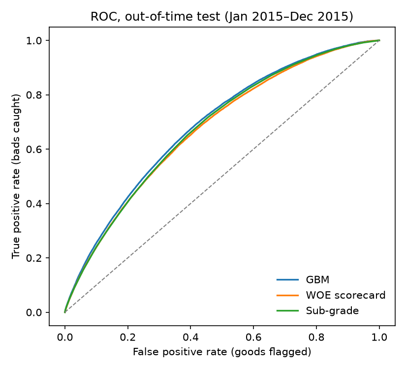
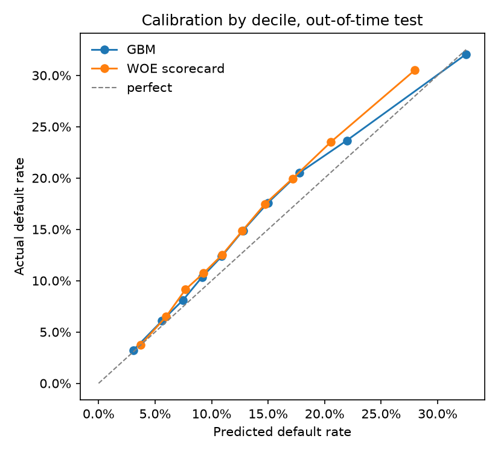

# Probability-of-default model report

The GBM ranks risk best on the Jan 2015–Dec 2015 out-of-time test: GBM AUC **0.688**, WOE scorecard **0.675**, Lending Club sub-grade **0.679** (GBM vs. sub-grade: +0.009). Neither model uses grade or interest rate as an input.

Loans: train 172,377 (Jan 2013–Jun 2014) · validation 90,615 (Jul 2014–Dec 2014) · out-of-time 283,026 (Jan 2015–Dec 2015). GBM trees: 397 (early-stopped on validation). Loans issued before 2013 are excluded because the extended credit-bureau fields were not reported yet.

## Performance

| model | split | auc | gini | ks | brier | mean_pd | default_rate | n |
| --- | --- | --- | --- | --- | --- | --- | --- | --- |
| Sub-grade benchmark | train | 0.649 | 0.298 | 0.220 |  |  | 12.70% | 172,377 |
| WOE scorecard | train | 0.667 | 0.333 | 0.241 | 0.1065 | 12.70% | 12.70% | 172,377 |
| GBM | train | 0.725 | 0.449 | 0.329 | 0.1023 | 12.68% | 12.70% | 172,377 |
| Sub-grade benchmark | valid | 0.667 | 0.334 | 0.249 |  |  | 14.13% | 90,615 |
| WOE scorecard | valid | 0.668 | 0.337 | 0.245 | 0.1161 | 13.43% | 14.13% | 90,615 |
| GBM | valid | 0.684 | 0.368 | 0.264 | 0.1151 | 13.75% | 14.13% | 90,615 |
| Sub-grade benchmark | oot | 0.679 | 0.357 | 0.262 |  |  | 14.89% | 283,026 |
| WOE scorecard | oot | 0.675 | 0.349 | 0.254 | 0.1209 | 13.07% | 14.89% | 283,026 |
| GBM | oot | 0.688 | 0.375 | 0.274 | 0.1198 | 13.62% | 14.89% | 283,026 |

Brier and mean PD are blank for the benchmark because sub-grade is a rank, not a probability.

## Calibration (GBM, out-of-time)

| decile | loans | predicted | actual | ratio |
| --- | --- | --- | --- | --- |
| 1 | 28,303 | 3.06% | 3.22% | 1.05 |
| 2 | 28,303 | 5.61% | 6.09% | 1.09 |
| 3 | 28,302 | 7.47% | 8.11% | 1.09 |
| 4 | 28,303 | 9.16% | 10.36% | 1.13 |
| 5 | 28,302 | 10.90% | 12.38% | 1.14 |
| 6 | 28,303 | 12.78% | 14.89% | 1.16 |
| 7 | 28,302 | 14.98% | 17.59% | 1.17 |
| 8 | 28,303 | 17.79% | 20.52% | 1.15 |
| 9 | 28,302 | 21.96% | 23.66% | 1.08 |
| 10 | 28,303 | 32.51% | 32.06% | 0.99 |

## Stability

Population stability index of the predicted PD, training vs. out-of-time (< 0.10 stable, 0.10–0.25 moderate shift, > 0.25 significant):

| model | psi |
| --- | --- |
| GBM | 0.014 |
| WOE scorecard | 0.005 |

## What drives the GBM (mean |SHAP|, out-of-time)

| feature | mean_abs_shap |
| --- | --- |
| fico_mid | 0.2090 |
| annual_inc | 0.1533 |
| acc_open_past_24mths | 0.1445 |
| loan_to_income | 0.1257 |
| dti | 0.1049 |
| purpose | 0.0868 |
| bc_open_to_buy | 0.0865 |
| total_acc | 0.0847 |
| mo_sin_old_rev_tl_op | 0.0824 |
| num_tl_op_past_12m | 0.0749 |

## Scorecard features by information value

| feature | iv | in_scorecard |
| --- | --- | --- |
| fico_mid | 0.122 | yes |
| annual_inc | 0.100 | yes |
| tot_hi_cred_lim | 0.084 | yes |
| bc_open_to_buy | 0.078 | yes |
| avg_cur_bal | 0.074 | yes |
| tot_cur_bal | 0.067 | yes |
| total_rev_hi_lim | 0.059 | yes |
| mort_acc | 0.048 | yes |
| acc_open_past_24mths | 0.046 | yes |
| dti | 0.042 | yes |
| home_ownership | 0.042 | yes |
| num_tl_op_past_12m | 0.042 | yes |

Full points table: `reports/scorecard_points.csv`.

## Example reason codes (5 highest-risk out-of-time loans)

| loan_id | sub_grade | pd_gbm | reason_1 | reason_2 | reason_3 |
| --- | --- | --- | --- | --- | --- |
| 63336407 | D5 | 78.9% | Loan amount relative to income | Income level | Age of oldest revolving account |
| 38547294 | F4 | 77.4% | Revolving balance | Loan amount relative to income | Accounts opened in the past 24 months |
| 66640508 | G2 | 76.6% | Income level | Loan purpose | Loan amount relative to income |
| 63348423 | E2 | 74.8% | Accounts opened in the past 24 months | Revolving balance | Loan amount relative to income |
| 62569747 | E3 | 74.6% | Accounts opened in the past 24 months | Revolving balance | Age of oldest revolving account |

## Design choices

- **No pricing inputs.** Grade, sub-grade, interest rate and installment are outputs of Lending Club's model; sub-grade is used only as the benchmark to beat.
- **Out-of-time validation.** The test period comes after the training period, as it would in production.
- **Full credit file.** 34 application-time inputs, including 15 extended bureau attributes (utilization, recent account openings, credit limits, delinquency history) reported from 2013.
- **Fair lending.** addr_state is not an input: geography can proxy for protected characteristics (incident INC-006).
- **Monotone constraints** on credit score, income, DTI, inquiries, delinquencies, public records, bankruptcies, utilization and loan-to-income, so the model can never reward a worse value.
- **Reason codes** are each loan's top three SHAP contributions that raised its risk.
