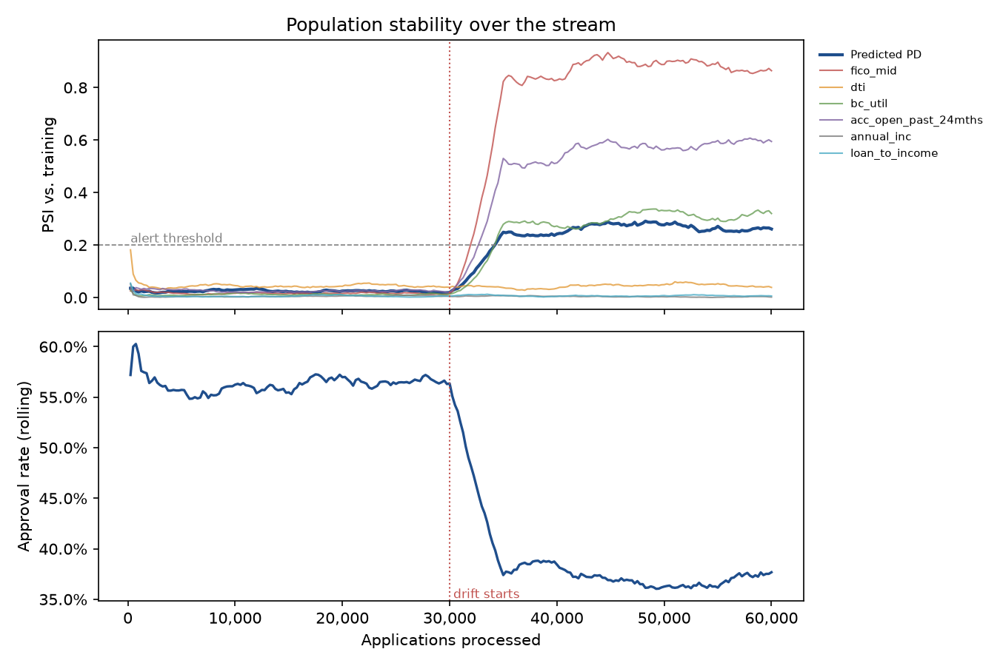

# Live scoring and monitoring report

Injected drift at application 30,000 was detected after **2,000 applications** by the `feature_psi:fico_mid` alert, with 0 false alarm(s) before it.

Backend: memory · 60,000 applications in 18s (3,418/s) · p95 scoring latency 0.30 ms per application · rolling window 5,000.

## Alerts

| rule | first_fired_at | detection_delay | value | threshold | active_at_end |
| --- | --- | --- | --- | --- | --- |
| feature_psi:fico_mid | 32,000 | 2,000 | 0.209 | 0.20 | True |
| approval_rate_drop | 32,500 | 2,500 | 0.102 | 0.10 | True |
| feature_psi:acc_open_past_24mths | 32,750 | 2,750 | 0.208 | 0.20 | True |
| score_psi | 34,250 | 4,250 | 0.202 | 0.20 | True |
| feature_psi:bc_util | 34,250 | 4,250 | 0.206 | 0.20 | True |

## Decisions

| period | applications | approval_rate | mean_pd |
| --- | --- | --- | --- |
| before drift | 30,000 | 56.2% | 13.92% |
| after drift | 30,000 | 37.1% | 17.54% |

## Drift scenario

From application 30,000, 60% of applicants come from a riskier channel: fico_mid -40, bc_util +25, acc_open_past_24mths +3.

## Monitors

| Monitor | Alert when |
| --- | --- |
| PSI of predicted PD and of 6 key inputs vs. training | > 0.2 |
| Approval rate vs. its first window | drops by more than 10% |
| Observed / predicted default rate | > 1.3 |
| p95 scoring latency | > 50 ms |

In this replay the outcome labels are the loans' real outcomes, so they do not react to injected drift: the calibration monitor shows the live-model gap but is not expected to fire for the synthetic drift.
