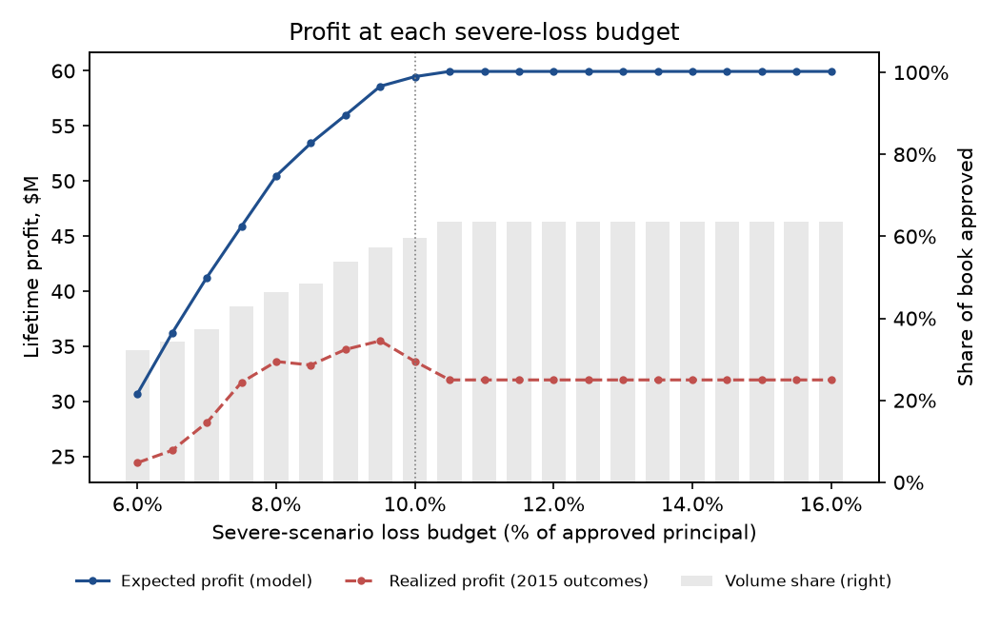

# Credit policy optimization report

The optimized policy funds **60%** of the 2015 book and earned **$33.6M** of realized profit (1.55% of principal), vs. $12.4M (0.34%) for approving every loan and $19.2M (0.55%) for a grade A–D cutoff, while holding severe-recession losses to 9.9% (budget 10%).

Book: 283,026 loans issued in 2015, $3,624M of principal. The policy is chosen from model predictions only; 2015 outcomes are used afterwards to measure realized profit.

## Policies compared

| policy | loans | volume_share | exposure_usd_m | expected_profit_usd_m | expected_profit_severe_usd_m | severe_loss_rate | realized_profit_usd_m | realized_return | meets_constraints |
| --- | --- | --- | --- | --- | --- | --- | --- | --- | --- |
| Approve all | 283,026 | 100% | 3,624 | 20.0 | -192.8 | 13.10% | 12.4 | 0.34% | no |
| Grades A-D only | 271,977 | 96% | 3,486 | 19.4 | -179.1 | 12.58% | 19.2 | 0.55% | no |
| Optimized | 162,463 | 60% | 2,165 | 59.5 | -44.7 | 9.92% | 33.6 | 1.55% | yes |

Constraints: severe-scenario loss ≤ 10% of approved principal · approved volume ≥ 50% of the book · grades E, F, G ≤ 15% of approved principal. Solver: highs.

## Which segments are approved

Rows are Lending Club grades; columns are deciles of predicted default risk (band 1 safest, band 10 riskiest). Blank = no loans.

| grade | band 1 | band 2 | band 3 | band 4 | band 5 | band 6 | band 7 | band 8 | band 9 | band 10 |
| --- | --- | --- | --- | --- | --- | --- | --- | --- | --- | --- |
| A | approve | approve | · | · | · | · | · | · | · | · |
| B | approve | approve | approve | approve | approve | · | · | · | · | · |
| C | approve | approve | approve | approve | approve | approve | approve | · | · | · |
| D | approve | approve | approve | approve | approve | approve | approve | approve | approve | · |
| E | approve | approve | approve | approve | approve | approve | approve | approve | approve | · |
| F |  | approve | approve | approve | approve | approve | approve | approve | approve | · |
| G |  |  |  | approve |  | approve | approve | approve | approve | · |

## Profit frontier

Best expected profit at each severe-loss budget (no volume floor), and what that policy actually earned.

| severe_loss_budget | volume_share | expected_profit_usd_m | realized_profit_usd_m | severe_loss_rate |
| --- | --- | --- | --- | --- |
| 6.0% | 32% | 30.7 | 24.4 | 6.00% |
| 6.5% | 34% | 36.2 | 25.5 | 6.50% |
| 7.0% | 37% | 41.2 | 28.1 | 6.98% |
| 7.5% | 43% | 45.9 | 31.7 | 7.49% |
| 8.0% | 46% | 50.5 | 33.6 | 8.00% |
| 8.5% | 49% | 53.4 | 33.3 | 8.50% |
| 9.0% | 54% | 56.0 | 34.7 | 8.98% |
| 9.5% | 57% | 58.6 | 35.5 | 9.41% |
| 10.0% | 60% | 59.5 | 33.6 | 9.92% |
| 10.5% | 64% | 59.9 | 31.9 | 10.42% |
| 11.0% | 64% | 59.9 | 31.9 | 10.42% |
| 11.5% | 64% | 59.9 | 31.9 | 10.42% |
| 12.0% | 64% | 59.9 | 31.9 | 10.42% |
| 12.5% | 64% | 59.9 | 31.9 | 10.42% |
| 13.0% | 64% | 59.9 | 31.9 | 10.42% |
| 13.5% | 64% | 59.9 | 31.9 | 10.42% |
| 14.0% | 64% | 59.9 | 31.9 | 10.42% |
| 14.5% | 64% | 59.9 | 31.9 | 10.42% |
| 15.0% | 64% | 59.9 | 31.9 | 10.42% |
| 15.5% | 64% | 59.9 | 31.9 | 10.42% |
| 16.0% | 64% | 59.9 | 31.9 | 10.42% |

## Profit model

Expected profit = (1 − PD) × scheduled interest × yield_good + PD × (scheduled interest × yield_bad − LGD × principal) − funding cost (4% a year on 1.5 principal-years). Yield factors are the share of scheduled interest actually collected on loans issued 2013–2014 (prepayment and default cut it):

| grade | yield_good | yield_bad |
| --- | --- | --- |
| A | 83.7% | 71.0% |
| B | 82.2% | 67.7% |
| C | 80.4% | 64.7% |
| D | 79.2% | 60.4% |
| E | 76.8% | 56.7% |
| F | 77.6% | 51.8% |
| G | 72.2% | 52.2% |

Calibration check, every 2015 loan: expected profit $20.0M vs. realized $12.4M.

## Limitations

- Lending Club data only contains approved loans, so this chooses which approved loans to fund; applicants Lending Club declined are unseen (reject inference is out of scope).
- Approve/decline by segment; credit-line size and pricing are held at what Lending Club offered.
- Funding cost and balance-years are simple assumptions; prepayment also shortens funding need.
