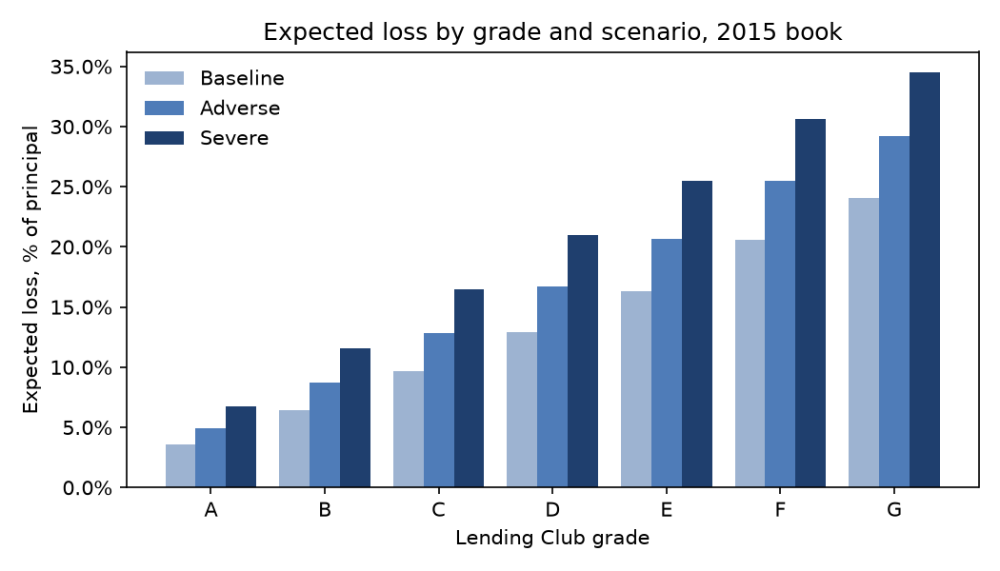
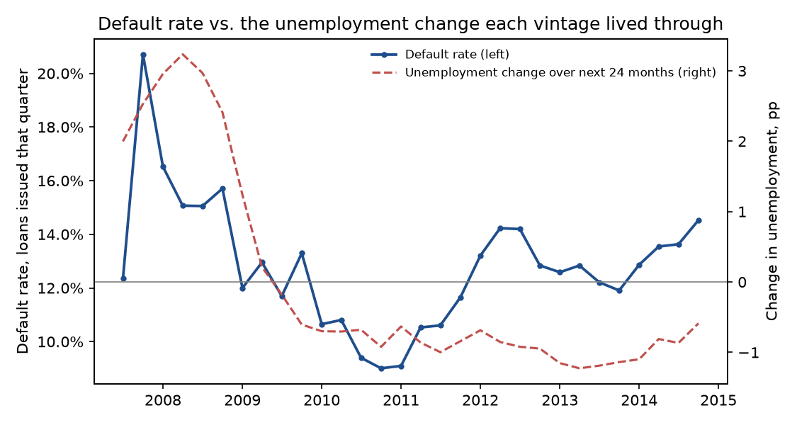

# Stress test report

A 5-point rise in unemployment would lift expected losses on the 2015 book from **$275M to $474M** (+73%). Each 1-point rise multiplies default odds by **1.16**, estimated from 335,558 loans issued Jun 2007–Dec 2014.

Book: 283,026 loans issued in 2015, $3,624M of principal. All parameters are estimated on loans issued before 2015.

## Backtest

2015 loans lived through an average unemployment change of **-0.45 pp** over their first 24 months. Under that realized path the model expects **$260M** of losses; actual losses were **$274M** (ratio 0.95).

## Scenarios

Unemployment change is the average over the next 24 months relative to today, in percentage points (Baseline 0, Adverse +2.5, Severe +5.0). The PD model was trained on loans that saw a -1.08 pp change, so every scenario shifts PD by beta × (scenario change − training change).

| scenario | mean_pd | expected_loss_usd_m | loss_rate |
| --- | --- | --- | --- |
| Baseline | 15.49% | 274.5 | 7.57% |
| Adverse | 20.58% | 364.8 | 10.07% |
| Severe | 26.72% | 474.0 | 13.08% |
| Realized | 14.69% | 260.2 | 7.18% |

| grade | loans | exposure_usd_m | lgd | loss_rate_baseline | loss_rate_adverse | loss_rate_severe | loss_rate_realized |
| --- | --- | --- | --- | --- | --- | --- | --- |
| A | 70,118 | 1,014.8 | 46.6% | 3.55% | 4.93% | 6.75% | 3.34% |
| B | 91,725 | 1,148.3 | 49.0% | 6.45% | 8.75% | 11.61% | 6.09% |
| C | 77,423 | 920.8 | 51.8% | 9.69% | 12.80% | 16.48% | 9.19% |
| D | 32,711 | 402.4 | 54.8% | 12.90% | 16.67% | 20.97% | 12.28% |
| E | 9,443 | 121.4 | 57.3% | 16.33% | 20.68% | 25.46% | 15.60% |
| F | 1,361 | 14.2 | 60.1% | 20.59% | 25.49% | 30.63% | 19.76% |
| G | 245 | 2.4 | 61.2% | 24.07% | 29.24% | 34.49% | 23.17% |

## Macro sensitivity

Binomial GLM of default on the 24-month unemployment change, with FICO-band intercepts, fit on 451 issue-month × FICO-band cohorts. Unemployment changes in the data range from -1.3 to +3.3 pp.

| term | coef | se | se_adjusted | odds_multiplier |
| --- | --- | --- | --- | --- |
| unemployment change (per pp) | 0.150 | 0.013 | 0.016 | 1.16 |

`se_adjusted` widens the binomial standard error for overdispersion (dispersion 1.6), because cohorts issued in the same months share the same economy.

## Loss given default

Realized loss of principal on defaulted loans issued before 2015 (net of recoveries and collection fees); overall 51.7%. Held at these through-the-cycle averages in every scenario.

| grade | defaults | lgd |
| --- | --- | --- |
| A | 4,023 | 46.6% |
| B | 12,775 | 49.0% |
| C | 13,934 | 51.8% |
| D | 9,162 | 54.8% |
| E | 3,013 | 57.3% |
| F | 822 | 60.1% |
| G | 94 | 61.2% |

## Limitations

- One recession in the data: the sensitivity rests mostly on 2007–2008 vintages, which are small.
- Lending Club tightened underwriting after 2008; FICO-band intercepts absorb only part of that mix shift.
- LGD is not stressed; downturn LGD would raise severe-scenario losses further.
- The 24-month window ignores defaults in months 25–36 shifting with later macro conditions.
